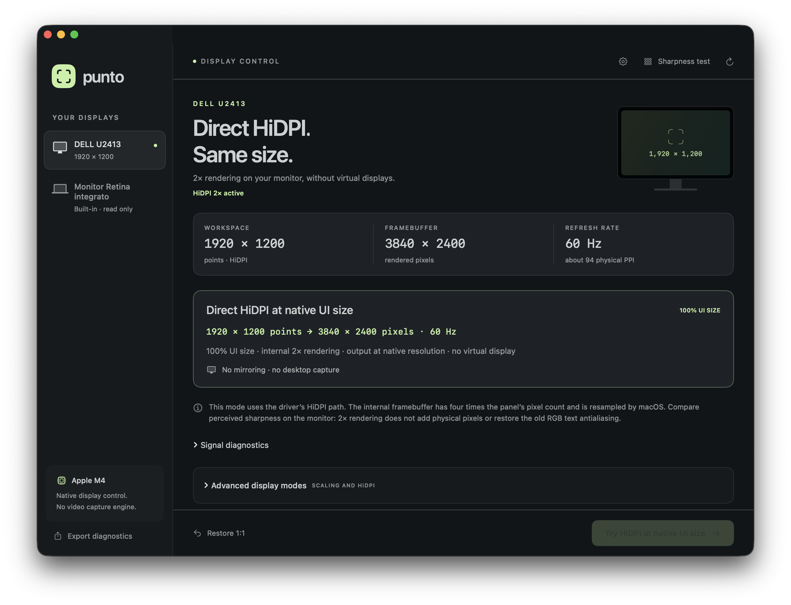
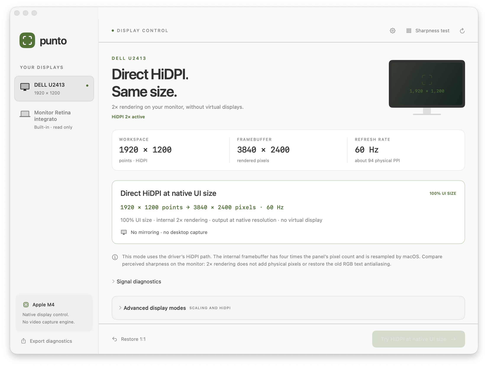

# Punto

**Explore your external display’s native modes and HiDPI rendering on macOS.**

[Italiano](README.it.md) · [Downloads](https://github.com/nerln/punto/releases/tag/v0.1.0) · [Privacy](docs/PRIVACY.md) · [MIT license](LICENSE)

Punto is an experimental native macOS utility for inspecting display modes and trying HiDPI at the same logical desktop size. It exposes modes already generated by WindowServer, including some that macOS hides from its public display-mode API.

**0.1.0 preview · Apple Silicon download · macOS 14+ build target.** Hardware validation so far covers a MacBook Pro M4 running macOS 27.2 with a Dell U2413. Compatibility with other hardware and OS versions remains unverified.



<details>
<summary>Light appearance</summary>



</details>

## What it does

- Enumerates public and private display modes, keeping logical size, rendering size and physical output timing separate.
- Tries direct HiDPI at the panel’s native desktop dimensions when WindowServer already provides the required mode.
- Gives each display change a 20-second confirmation window and a separate recovery process.
- Inspects connection color formats and exports local diagnostics without display UUIDs or hardware serial numbers.
- Provides English and Italian interfaces and follows the system’s light or dark appearance.
- Draws an on-demand Metal sharpness pattern without a continuous rendering loop.

Normal launch only reads the display configuration. A confirmed direct mode can remain active after Punto closes; keeping the app open is unnecessary for that rendering path. Reconnection and login behavior depend on macOS.

## The result actually tested

On the Dell U2413, Punto selected a hidden direct HiDPI mode and verified desktop geometry, AppKit backing scale and driver-reported physical timing:

| Measurement | Native 1× | Direct HiDPI 2× |
| --- | --- | --- |
| Logical desktop | 1920 × 1200 points | 1920 × 1200 points |
| Rendering buffer | 1920 × 1200 pixels | 3840 × 2400 pixels |
| AppKit backing scale | 1× | 2× |
| Physical timing reported by the driver | 1920 × 1200 at 60 Hz | 1920 × 1200 at 60 Hz |
| Virtual display or mirroring | None | None |

**The person testing this Dell did not perceive a meaningful improvement in text clarity.** This release is a display-control and diagnostic preview, not a demonstrated cure for blurry text. An RGB Full Range trial also produced no meaningful visual improvement; the original YCbCr output was already 4:4:4.

The private mode’s numeric index is discovered at runtime rather than hard-coded from the development session.

## What HiDPI changes

HiDPI at the same logical desktop size draws a 2× image along both axes, then fits it to the panel. A 1920 × 1200 desktop uses a 3840 × 2400 rendering buffer on this path, while the monitor continues to receive its native 1920 × 1200 signal. The interface stays the same size; resampling still happens internally.

This adds rendering samples, not physical pixels. It does not replace the system font renderer or restore ClearType/subpixel antialiasing across applications. Four times the rendering pixels is a theoretical area ratio, not a measured GPU-load multiplier. Punto does not certify a Metal-only pipeline for the entire macOS desktop.

## Download and open

1. Download the Apple Silicon ZIP and its checksum from [GitHub Releases](https://github.com/nerln/punto/releases/tag/v0.1.0).
2. Unzip it and move `Punto.app` to Applications or your user’s Applications folder.
3. Open Punto and select the external monitor you want to inspect.

Preview builds are **ad-hoc signed, without a Developer ID signature or Apple notarization**. macOS may block a downloaded build. If you decide to trust it, follow Apple’s documented **System Settings → Privacy & Security → Open Anyway** process. See [Apple’s guidance on opening downloaded apps](https://support.apple.com/en-us/102445).

The packaged download is arm64 only. The source has a macOS 14 deployment target; that target does not guarantee that private display APIs work on macOS 14 or every Apple Silicon Mac.

## Use

Choose the monitor, inspect its current geometry, then try direct HiDPI if the required mode is available. Confirm within 20 seconds to keep it. Use the native 1:1 action to return to the panel’s unscaled desktop mode.

A separate process retains the previous display snapshot during a trial and attempts recovery on timeout or unexpected app termination. Recovery depends on the driver accepting its former configuration, so keep the built-in display available while experimenting.

Advanced controls also expose driver-listed modes, connection color formats and the prototype’s optional virtual-display backend. The main direct HiDPI path does not use that backend. A virtual-display session needs Punto to remain open and ends when the app quits.

The verified direct path needs no administrator account, display override, EDID edit or SIP change. Private APIs can change, and a mode appearing in WindowServer’s table does not guarantee that every driver will accept it.

## Build and check

Use macOS, Xcode with Swift 6 or newer, and an Apple Silicon Mac for the arm64 package. The app has no external package dependencies.

```sh
swift test
./scripts/build-app.sh
./scripts/package-release.sh 0.1.0
```

Outputs:

- `build/Punto.app`
- `build/Punto-0.1.0-macOS-arm64.zip`
- `build/Punto-0.1.0-macOS-arm64.zip.sha256`

Read-only diagnostics can also be printed from a build:

```sh
.build/debug/Punto --diagnose
```

`swift test` does not change display modes. Tests needing a particular hardware mode skip when that fixture is unavailable. CI compiles, tests and packages on an arm64 macOS runner; it does not validate physical image quality or switch its display.

Development-only smoke commands such as `--smoke-native-hidpi` and `--smoke-rgb` deliberately change a connected display, then check recovery. They are separate from the automated test suite. Direct HiDPI application and normal restoration were verified on the hardware above; crash-recovery checks also covered the earlier virtual-display and RGB paths. These checks do not certify text quality, energy use or sleep/wake reliability.

## Technical background

- [Apple: points, pixels and high-resolution rendering](https://developer.apple.com/library/archive/documentation/GraphicsAnimation/Conceptual/HighResolutionOSX/Explained/Explained.html)
- [FineDisplay: selecting hidden WindowServer modes](https://github.com/ofbakirci/finedisplay/blob/main/Sources/FineDisplayKit/Display.swift)
- [AllRez: private display-mode description layout](https://github.com/joevt/AllRez/blob/master/AllRez/AppleMisc.h)
- [WebKit: removal of system subpixel antialiasing](https://bugs.webkit.org/show_bug.cgi?id=193095)

Created by Eugenio Nerelli. Source code is available under the [MIT license](LICENSE).
